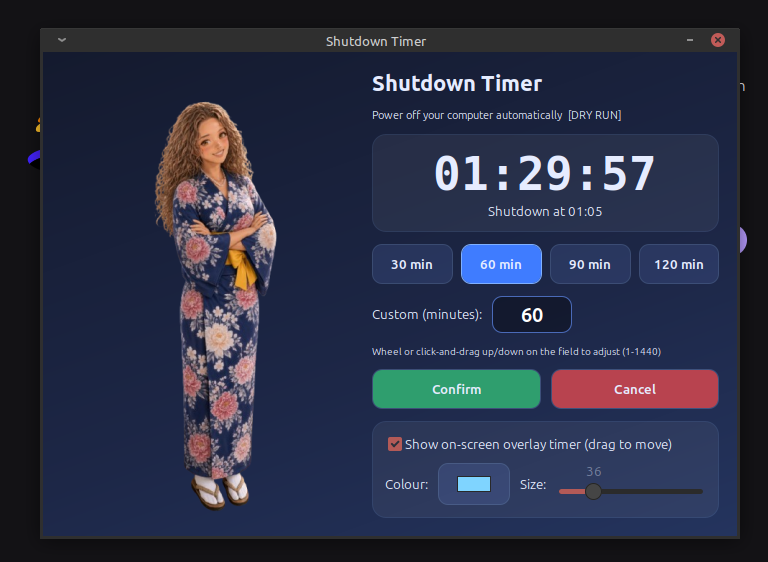

# Shutdown Timer

A pretty GTK3 auto-shutdown timer for Linux with an always-on-top overlay countdown.



## Features
- Presets: **30 / 60 / 90 / 120 minutes**, or any custom value (1–1440 min)
- Mouse-friendly minute input: scroll wheel, **Shift+wheel** (×5), or **left-click and drag** up/down
- **Confirm** to start, **Cancel** to abort at any time
- Live countdown plus the exact **"Shutdown at HH:MM"** time
- Draggable, **always-on-top overlay** timer with selectable colour and size (remembered between runs)
- Desktop notification **1 minute before** shutdown
- Shuts down via `systemctl poweroff` (systemd-logind) — **no sudo needed**
- Asks for confirmation if you close the window while a countdown is running

## Requirements
- Linux with **systemd / logind**
- **X11** session recommended (overlay positioning/always-on-top may be limited on Wayland)
- Python 3, PyGObject with **GTK 3**, `notify-send` (libnotify)

On Debian/Ubuntu/Mint/Xubuntu:
```bash
sudo apt install python3-gi gir1.2-gtk-3.0 libnotify-bin
```

## Installation
```bash
git clone https://github.com/SebMaliszewski/shutdown-timer.git && cd shutdown-timer && ./install.sh
```
The installer is per-user (no root) and idempotent. It installs:

| What | Where |
|---|---|
| App + assets | `~/.local/share/shutdown-timer/` |
| Icon | `~/.local/share/icons/hicolor/256x256/apps/shutdown-timer.png` |
| Start-menu entry | `~/.local/share/applications/shutdown-timer.desktop` |
| Command | `~/.local/bin/shutdown-timer` (symlink) |

After installing, find **Shutdown Timer** in your application menu (Utility / Accessories) or run `shutdown-timer`.

## Usage
1. Pick a preset or set custom minutes:
   - **Mouse wheel** over the minutes field: ±1 min
   - **Shift + wheel**: ±5 min
   - **Left-click and drag** up/down: change value continuously
   - Or simply type a number
2. Click **Confirm** — the countdown starts and the shutdown time is shown.
3. Click **Cancel** to stop it.

### Overlay
When enabled, a small always-on-top timer floats over your desktop. Drag it anywhere with the mouse; choose its colour and font size in the main window. Position, colour and size are saved.

### Command-line flags
| Flag | Description |
|---|---|
| `--dry-run` | Do everything, but print instead of shutting down (safe testing) |
| `--autostart-seconds N` | Start a countdown of N seconds immediately (testing) |

Example: `shutdown-timer --dry-run --autostart-seconds 90`

## Settings
Stored in `~/.config/shutdown-timer/settings.json`:
```json
{ "minutes": 60, "overlay": true, "color": "#7fd4ff", "size": 36, "x": 100, "y": 100 }
```

## How shutdown works
When the timer reaches zero, the app runs `systemctl poweroff`. On desktop systems systemd-logind allows the active local user to power off without root, so **no sudo** is required. The installer checks logind's `CanPowerOff`; if it isn't `yes` (e.g. other users logged in, remote session, restrictive polkit), you may be asked for a password or shutdown may be denied.

## Uninstall
```bash
./uninstall.sh          # keeps your settings
./uninstall.sh --purge  # also removes ~/.config/shutdown-timer
```

## Troubleshooting
- **"python3 with PyGObject (GTK 3) is required"** — install: `sudo apt install python3-gi gir1.2-gtk-3.0 libnotify-bin`
- **No menu entry** — log out/in or run `update-desktop-database ~/.local/share/applications`; some panels need a restart (`xfce4-panel -r`).
- **`shutdown-timer: command not found`** — add `~/.local/bin` to your `PATH`.
- **Overlay not on top / can't move** — you're likely on Wayland; use an X11 session.
- **Shutdown asks for a password / fails** — check `busctl call org.freedesktop.login1 /org/freedesktop/login1 org.freedesktop.login1.Manager CanPowerOff`; adjust polkit if needed.
- **No 1-minute warning** — install `libnotify-bin` and make sure a notification daemon is running.

## Credits
Character art provided by the author.

## License
[MIT](LICENSE) © 2026 SebMaliszewski
